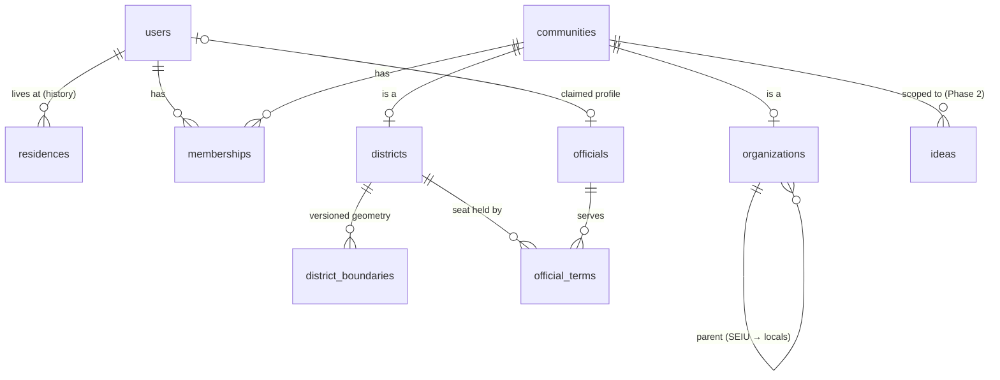

# Identity & Affiliation Schema

Reference design for how a person relates to every group they belong to:
unions, tenant associations, town halls, and the political districts they
live in. DDL: `schema/001_identity_affiliations.sql`. Tests:
`tests/affiliations_test.sql` (20 tests, passing on PostgreSQL 16 + PostGIS).

## The core idea

There are two kinds of affiliation, and they behave differently:

| | Districts | Organizations |
|---|---|---|
| Examples | State Senate 59, Assembly 65, Council 1, NY-10 | 1199SEIU, 32BJ, a tenants association, a town hall |
| How you get one | **Derived** from your address | **Joined** (open, approval, invite) |
| Can you leave? | Only by moving | Yes |
| Changes when | You move, or lines are redrawn | You join/leave, org approves |

Both are stored as **communities** (one supertype table) with two subtype
tables, `districts` and `organizations`. Every affiliation is a row in one
table, `memberships`. So the worst case (a union member in a tenants
association and a town hall, living in six overlapping districts) is just
nine membership rows, and "show me everything I'm part of" is one join.

The alternative (a table per profile type: `union_members`,
`tenant_members`, `district_residents`, ...) makes every cross-cutting
query a UNION of N tables and needs a migration for every new group type.

The non-participant is covered for free: a person who never joins anything
still gets their districts from their address, so they still see who
represents them and can post to their district.

## Entity diagram



## Tables

| Table | Purpose | Key rules |
|---|---|---|
| `users` | People (constituents, moderators, admins) | Case-insensitive unique handle/email |
| `residences` | Geocoded home point + postcode, with history | One primary residence at a time (exclusion constraint). Street address is not stored |
| `communities` | Supertype: name, slug, kind | `(id, kind)` + composite FKs: a community is a district OR an org, never both |
| `districts` | District identity: type, region, code, seats, level | Identity survives redistricting |
| `district_boundaries` | MultiPolygon per district per date range | Valid geometry only; no overlapping versions per district |
| `organizations` | Org type, parent, optional location, join policy | No hierarchy cycles (trigger); tenant associations need a building location |
| `memberships` | Person ↔ community | Districts only via `geo`, orgs never via `geo`; one open membership per pair; history kept |
| `officials` | Elected people (optionally linked to a user account) | |
| `official_terms` | Who holds which seat when | No two people in the same seat at the same time |

## How district membership stays correct

- **Address set or changed** → `move_residence()` ends the old residence and
  inserts the new one. A deferred trigger runs `sync_geo_memberships()` once
  at commit. Districts you're still in keep the same membership row; ones you
  left are ended; new ones are added.
- **Redistricting** → load new `district_boundaries` versions with a start
  date, close the old ones, run `resync_all_geo_memberships()` (production:
  chunked queued job). Senate District 59 stays the same community, so its
  ideas and history carry over.
- **Point on a boundary line** → one district per type, lowest code wins,
  flagged for review (EDGE_CASES.md).

## Privacy controls (built into the schema)

Union membership and political participation are sensitive (see
COMPLIANCE.md), so the defaults are conservative:

- `visibility` per membership: `private` (default), `members`, `public`.
  `community_members(community, viewer)` enforces it.
- `count_in_stats`: separate consent to be counted in aggregates. Off by
  default for orgs; on for districts (residency counts only).
- `community_overlap(a, b, k)` returns NULL below k (default 10) so small
  groups ("the 3 32BJ members on your block") can't be singled out.

## What the app renders (see `queries/affiliation_queries.sql`)

1. My communities: districts grouped federal/state/local, then orgs
2. Who represents me: officials for each of my districts
3. Overlap: "1199SEIU members in your Senate district: 12"
4. Union rollup: parent union and its locals
5. Officials who represent a tenants association's building

## Ideas hook (task 2.2)

Ideas are scoped to a community:

```sql
community_id uuid NULL REFERENCES communities (id)  -- NULL = citywide/public board
```

Only active members of a community can post to it. A "my communities"
feed is ideas whose `community_id` is in the viewer's active memberships.

## Data sources (task 1.7)

- Congressional and state legislative districts: U.S. Census TIGER/Line shapefiles
- NYC council and community districts: NYC Department of City Planning
- Officials: seeded from Congress.gov + OpenStates, already integrated in `apps/api` (PHASES open decision 6)

## Scale notes (architecture checklist: Database & Storage)

- GiST indexes on every geometry; partial indexes on active memberships
- Memberships are ~5 to 15 rows per user: no partitioning needed at MVP
- "Who represents me" changes only on move, redistricting, or election:
  cache it per user and invalidate on those three events
- Read views can be served from a read replica; geo sync writes go to primary
- Redistricting resync runs as a chunked background job, not one transaction

## Run the tests

```bash
createdb pp_test
psql -v ON_ERROR_STOP=1 -d pp_test -f packages/db/schema/001_identity_affiliations.sql
psql -v ON_ERROR_STOP=1 -d pp_test -f packages/db/tests/affiliations_test.sql
```

Test geometry is synthetic rectangles and officials are fictional.
